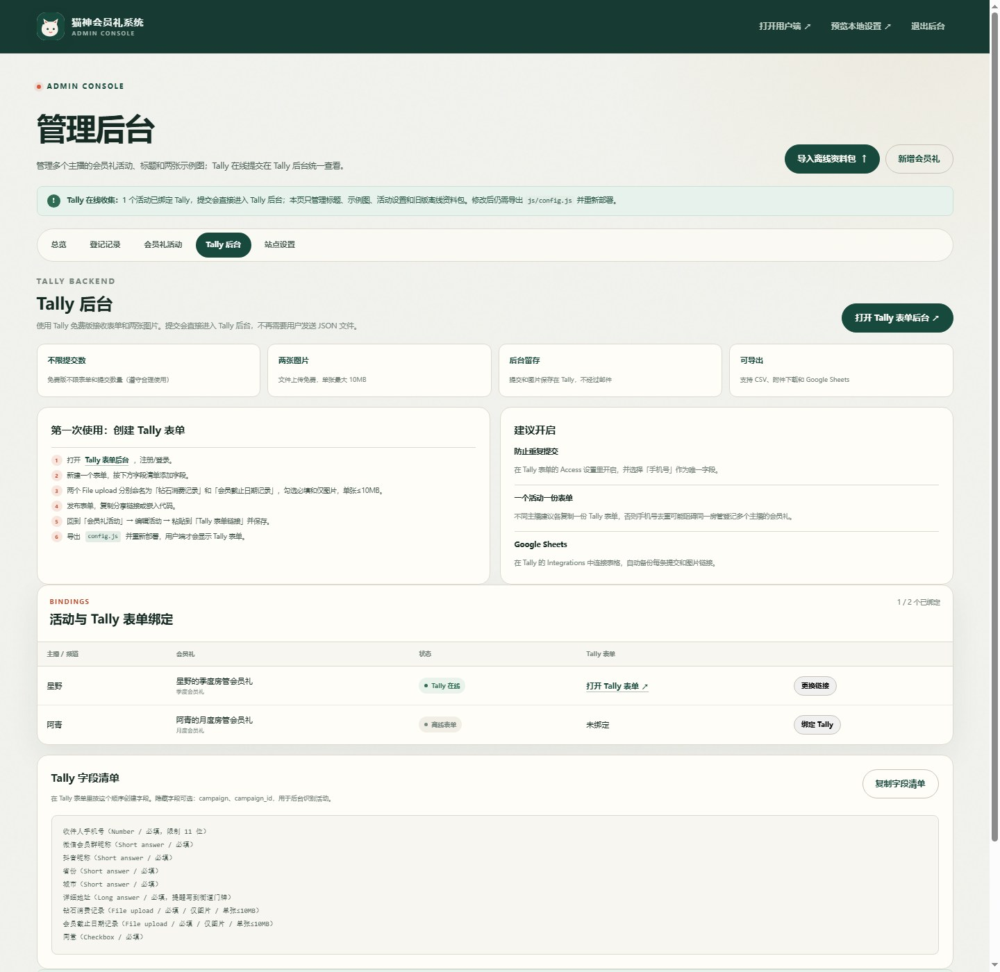

# 猫神会员礼系统

一个给**多个主播统一登记房管会员礼**的静态网页。你是代主播收集和发放会员礼的管理员，不是送礼人本人，因此页面文案统一使用「替主播登记 / 主播 / 频道 / 房管」的口径。

**技术架构：**

- 前端：纯 HTML + CSS + JavaScript，可直接部署 GitHub Pages；
- 表单与数据后端：**Tally**（免费版）；
- 两张证明图片：Tally 文件上传；
- 管理员后台：Tally 的 Submissions 后台；
- 本仓库后台：只管理主播活动、标题、两张示例图和 Tally 表单链接。




> 以上截图使用测试数据，仅用于展示界面。

---

## 当前线上网址是什么？

**目前还没有。** 这个项目现在只是你电脑上的静态文件，尚未部署到任何公网服务器，所以现在没有可以直接发给房管的网址。

README 里出现的 `https://你的用户名.github.io/仓库名/` 是**占位符**，不是已经可访问的地址。测试时用过的 `http://127.0.0.1:...` 只是本机临时地址，已经关闭，手机无法访问，也不能作为正式链接。

部署到 GitHub Pages 之后，网址格式才是：

```
https://你的GitHub用户名.github.io/仓库名/
```

例如：

- GitHub 用户名是 `catshen`，仓库名是 `member-gift`；
- 用户端网址就是 `https://catshen.github.io/member-gift/`；
- 管理后台是 `https://catshen.github.io/member-gift/admin.html`。

如果仓库名正好是 `catshen.github.io`，网址则是 `https://catshen.github.io/`。

### 得到这个网址的最短步骤

1. 登录 GitHub，点 **New repository**，创建一个 **Public** 仓库，例如 `member-gift`；
2. 把 ZIP 解压后 `catshen-member-gift` 文件夹里的**全部内容**上传到仓库根目录。根目录必须能看到 `index.html`，不能多套一层文件夹；
3. 进入仓库 **Settings → Pages**；
4. Source 选择 **Deploy from a branch**，Branch 选 `main`，Folder 选 `/ (root)`，保存；
5. 等待 1–2 分钟，Pages 页面会显示实际网址；
6. 用户端就是该网址；管理后台是在后面加 `admin.html`。

> 这一步必须用你自己的 GitHub 账号完成。我没有你的账号，不能替你创建仓库或开启 Pages。

---

## 一、为什么选 Tally

我比较了 Tally、表单大师和 Web3Forms：

| 服务 | 免费提交额度 | 免费文件上传 | 数据后台 |
| --- | --- | --- | --- |
| **Tally** | **不限表单、不限提交**（合理使用） | **免费，单文件 10MB，不限文件数** | **有，可直接查看/下载附件/导出 CSV** |
| 表单大师 | 5000 条/月 | **免费版 0GB，文件上传不可用** | 有 |
| Web3Forms | 250 条/月 | 不支持文件 | 主要靠邮件，容易漏 |

Tally 的免费文件上传是最关键的：你的表单需要收集**钻石消费记录**和**会员截止日期记录**两张图。表单大师免费版文件上传流量为 0GB，直接排除；Web3Forms 只发邮件，不符合“怕丢”的要求。

官方依据：

- [Tally 定价：免费版不限表单和提交](https://tally.so/pricing)
- [Tally 文件上传：免费版单文件 10MB，不限文件数量](https://tally.so/help/file-uploads)
- [表单大师版本对比：免费版文件上传流量 0GB](https://biaodan100.com/version_price.htm)

> Tally 免费版会有 Tally 品牌标识；自定义域名、去除品牌等需要 Pro。当前需求用免费版足够。

---

## 二、数据怎么走（重要）

```
房管打开 GitHub Pages
        ↓
选择主播 / 会员礼
        ↓
在页面内嵌的 Tally 表单中填写手机号、地址、昵称
        ↓
上传钻石消费记录 + 会员截止日期记录
        ↓
提交 → 数据直接进入管理员 Tally 账号后台
        ↓
管理员在 Tally 的 Submissions 查看、下载图片、导出 CSV
```

**Tally 记录不会进入本仓库的 admin.html。**  
`admin.html` 是“活动设置后台”，用于管理标题、主播活动、示例图和 Tally 表单链接。真正的提交数据在 Tally 后台。

### 可选：离线备用模式

默认情况下，活动没有绑定 Tally 时，用户端会显示「在线表单尚未开放」，不会让用户误提交到本机。你可以在活动编辑窗口里手动勾选「未绑定 Tally 时允许离线资料包」来启用旧版资料包模式。

这个模式需要用户下载 JSON 文件发给管理员，管理员再导入；只建议作为临时备用，正式收集请用 Tally。

---

## 三、你需要先做一次 Tally 表单

因为 Tally 表单属于你的账号，我无法代替你注册或创建一个归你所有的表单。创建一次后可以长期复用、复制。

### 1. 创建账号

打开 <https://tally.so/forms> 注册/登录。

### 2. 新建表单

建议每个主播 / 每个会员礼**各建一份表单**，这样：

- 表单标题可以对应主播；
- 防止重复提交只限制单个活动，不会阻止同一个房管登记其他主播的会员礼；
- Tally 后台按表单查看更清晰。

### 3. 添加字段

按这个顺序添加：

| 字段 | Tally 类型 | 设置 |
| --- | --- | --- |
| 收件人手机号 | Number / Short answer | 必填，限制 11 位（Number 可设 min/max） |
| 微信会员群昵称 | Short answer | 必填 |
| 抖音昵称 | Short answer | 必填 |
| 省份 | Short answer | 必填 |
| 城市 | Short answer | 必填 |
| 详细地址 | Long answer | 必填，提示写到街道门牌 |
| 钻石消费记录 | **File upload** | 必填，Allowed files 选图片，Max file size 10MB |
| 会员截止日期记录 | **File upload** | 必填，Allowed files 选图片，Max file size 10MB |
| 同意 | Checkbox | 必填 |

可选隐藏字段（用于识别活动）：

- `campaign`
- `campaign_id`

如果只用一个表单服务多个主播，建议加上这两个隐藏字段。每份表单单独用则不需要。

Tally 的字段校验由你在 Tally 表单里设置。手机号建议用 Number 字段并限制 11 位；省市和详细地址建议都设为必填。若你需要和旧版一样的强制省市下拉校验，请保留离线模式或后续增加 Supabase 自建后端。

### 4. 建议开启的设置

- **Prevent duplicate submissions**：选择「手机号」作为唯一字段，防止同一个人重复提交同一活动；
- **Google Sheets 集成**：在 Tally 的 Integrations 里连接一个 Google Sheet，作为自动备份；即使 Tally 表单被误操作，表格里还有记录；
- 文件下载：在 Tally 的 Submissions 页面可以单张下载，也可以批量下载当前页的附件。

### 5. 发布并复制链接

点击 Publish，复制分享链接。

链接通常长这样：

```
https://tally.so/r/xxxxxx
```

---

## 四、把 Tally 链接绑定到活动

打开你的：

```
https://你的用户名.github.io/仓库名/admin.html
```

首次进入设置管理员密码（只保护本机活动设置，不是 Tally 密码）。

进入：

**会员礼活动 → 编辑活动 → Tally 表单链接**

粘贴：

- Tally 分享链接：`https://tally.so/r/xxxxxx`
- 或 Tally 嵌入代码中的链接：`https://tally.so/embed/xxxxxx`

保存后：

1. 点「预览本地设置」，检查 Tally 表单是否能显示；
2. 导出 `config.js`；
3. 用下载的文件替换项目中的 `js/config.js`；
4. 提交并推送到 GitHub；
5. 等 GitHub Pages 更新，按 `Ctrl + F5` 刷新。

之后该活动的用户端会直接显示：

- 主播 / 频道；
- 两张管理员设置的示例图；
- 内嵌的 Tally 表单。

用户提交后，资料进入 Tally，不再下载 JSON 文件。

---

## 五、标题和示例图怎么改

### 系统标题

后台 → 站点设置 → **系统标题**。

默认：

```
猫神会员礼系统
```

### 首页主标题

后台 → 站点设置 → **首页主标题**。

默认：

```
替主播，把每一份|会员礼登记清楚。
```

其中 `|` 是强制换行符：

```
替主播，把每一份
会员礼登记清楚。
```

你可以改成例如：

```
替主播登记|房管会员礼收件信息。
```

### 活动标题 / 主播

后台 → 会员礼活动 → 编辑：

- **活动标题**：例如「星野的季度房管会员礼」；
- **主播 / 频道**：例如「星野」；
- **会员礼类型**：季度会员礼、月度会员礼或自定义；
- **活动说明**；
- **截止日期**；
- **Tally 表单链接**。

### 两张示例图

同一个活动编辑窗口里：

- 钻石消费记录示例图；
- 会员截止日期示例图。

这两个上传区只在管理员后台出现。用户端只能看到已经发布的示例图。

修改后同样要**导出 config.js → 覆盖 → 重新部署**，所有访客才会看到。

> 默认没有绑定任何 Tally 表单，所以活动会显示「待开放」。绑定后才会出现可填写的表单。这是为了避免用户在未配置时误用离线资料包。

### 离线备用开关

活动编辑窗口里默认关闭「未绑定 Tally 时允许离线资料包」。只有在你明确需要时再开启；Tally 在线模式不需要它。

---

## 六、GitHub Pages 部署

1. 解压 ZIP；
2. 把 `catshen-member-gift` 文件夹里的**全部内容**放到 GitHub 仓库根目录；
3. Settings → Pages → Deploy from a branch → 选择分支和 `/ (root)`；
4. 等待构建；
5. 打开：

```
https://你的用户名.github.io/仓库名/
```

管理后台：

```
https://你的用户名.github.io/仓库名/admin.html
```

`.nojekyll` 已包含，避免 GitHub Pages 的 Jekyll 处理影响静态文件。

---

## 七、管理员后台各标签

- **总览**：本机活动数量、Tally 绑定数量、旧版离线资料包；
- **登记记录**：只显示旧版离线 JSON 资料包。Tally 在线提交请去 Tally 后台；
- **会员礼活动**：新增/编辑活动、标题、主播、两张示例图、Tally 链接；
- **Tally 后台**：Tally 免费版说明、绑定状态、建表单步骤、字段清单，一键复制清单；
- **站点设置**：系统标题、首页标题、公开提示、导出 config.js、完整备份。

Tally 的提交、附件下载、CSV 导出都在 **Tally 自己的后台**，不在本页面。

---

## 八、免费额度与数据安全

### Tally 免费版

- 不限表单、不限提交（合理使用政策）；
- 文件上传免费，单文件最大 10MB；
- 不限制文件总数（遵守合理使用）；
- 提交和附件长期保存在 Tally 账号，除非你主动删除；
- 支持 CSV、附件下载、Google Sheets。

### 安全提醒

1. 资料和图片会发送给 Tally（欧盟公司，GDPR 合规）；请自行确认房管们是否接受该第三方处理。
2. 请给 Tally 账号设置强密码和两步验证；Tally 账号密码是数据安全的核心。
3. 本仓库的 admin.html 密码只保护“本机活动设置和离线资料包”，不等同于 Tally 后台权限。
4. Tally 表单链接和后台链接不要发到公开群；提交链接可以公开，后台链接不要。
5. 示例图会以 data URL 写入 `config.js`，文件可能较大，这是正常的。
6. 不要将 Tally 管理页面截图发到公开渠道；截图里可能包含房管个人信息。

---

## 九、常见问题

**Tally 表单没显示？**  
先点页面上的「新窗口打开」检查表单本身能否打开；确认链接是 `tally.so/r/...` 或 `tally.so/embed/...`；确认 `config.js` 已更新并强刷。

**后台改了标题/示例图，用户端没变化？**  
需要导出 `config.js` 覆盖部署，不是只保存本机。

**Tally 记录会出现在 admin.html 吗？**  
不会。请到 Tally 的 Submissions 查看。

**同一个房管要登记多个主播的会员礼怎么办？**  
每个主播/会员礼各用一份 Tally 表单，避免手机号去重限制跨活动。

**用户想修改已经提交的 Tally 资料？**  
Tally 免费版没有内置的查询码修改流程。请联系管理员在 Tally 后台处理，或让用户重新提交并注明。需要“用户自助查询修改”就必须自建后端/Supabase 方案。

**表单大师可以吗？**  
免费版文件上传 0GB，不能收两张截图，因此不采用。

**需要 Pyodide 吗？**  
不需要。这个版本没有 Python 逻辑，校验、图片压缩、加密和存储都是浏览器原生 JS / WebCrypto。

---

## 十、文件结构

```
catshen-member-gift/
├── index.html
├── admin.html
├── .nojekyll
├── css/style.css
├── js/
│   ├── config.js        # 标题、活动、示例图、Tally 链接
│   ├── regions.js
│   ├── common.js
│   ├── store.js
│   ├── app.js
│   └── admin.js
├── assets/
│   ├── favicon.svg
│   ├── example-diamond.svg
│   └── example-expiry.svg
└── docs/
```

---

## 十一、当前状态

- 首页文案已改为“替多个主播统一登记房管会员礼”，不再使用“猫神的心意”这种送礼口吻；
- 管理员活动字段使用「主播 / 频道」；
- 支持多个主播 / 多会员礼；
- 支持每个活动双示例图；
- 已接入 Tally 嵌入与 Tally 配置后台；
- Tally 免费表单需要你自己创建一次并粘贴链接。
